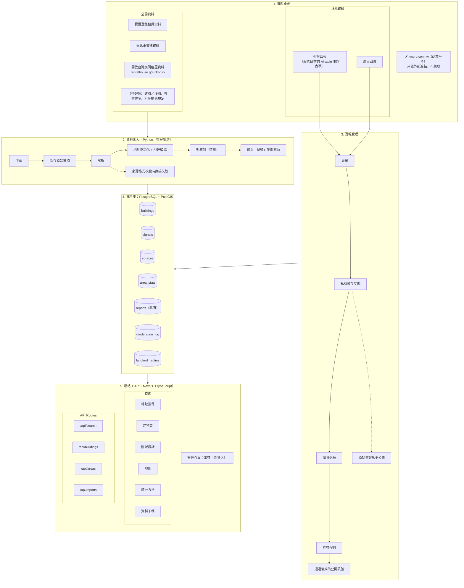

# 系統架構 

## 目錄

1. [目標與範圍](#1-目標與範圍)
2. [設計原則](#2-設計原則)
3. [整體架構](#3-整體架構)
4. [技術選擇](#4-技術選擇)
5. [資料模型](#5-資料模型)
6. [API](#6-api)
7. [關鍵難題](#7-關鍵難題)
8. [分階段建置](#8-分階段建置)
9. [待釐清問題](#9-待釐清問題)

---

## 1. 目標與範圍

由於開發的難度不一樣，這個專案將分成兩個層次：

| 層次 | 回答的問題 | 對應 |
|---|---|---|
| **區域租金統計** | 「這個縣市／行政區的租金行情大概多少？」 | US-01 ～ US-13（MVP 1–3） |
| **單一房屋可信度** | 「這個地址的房子有沒有需要注意的地方？」 | 尚未寫成 user story（見 [§9](#9-待釐清問題)） |

區域統計只用公開資料、彙總到區域層級，風險低。單一房屋可信度會落到可辨識的地址，還涉及使用者回報，**需要審核機制與法律檢視**才能上線。

---

## 2. 設計原則

> [!IMPORTANT]
> **呈現「訊號」，不呈現「分數」。**
>
> 不做「可信度 62 分」這種單一分數。分數的權重無法說明，會暗示我們有其實沒有的資料覆蓋率（例如違建資料目前只有臺北市），而且對可辨識的地址給低分，可能構成誹謗。

建物頁面列出的是一條一條有來源、有日期、有限制說明的事實：

```
- 臺北市違建紀錄：1 筆（頂樓加蓋）｜來源：臺北市建管處｜蒐集：2026-03
- 已審核的租客回報：2 則（拒絕租補）｜2025–2026
- 所在行政區租金中位數（實價登錄）：NT$18,500／月｜n=143｜2026 Q2
❔ 此縣市沒有違建資料
```

其他原則（延續 [user-stories.md](user-stories.md) 的精神）：

- **「查無紀錄」與「沒有資料」必須長得不一樣。** 沒有資料的地區不能看起來像「安全」。
- **缺漏不顯示為 0。** 樣本數不足時明確標示，不硬算。
- **刊登租金不得呈現為實際成交租金。**
- **每一筆訊號都帶來源、蒐集期間、更新時間。**
- **以建物為單位，不以人為單位。** 不公開房東姓名。
- **匯入失敗要顯示失敗**，不要安靜跳過（資料來源改格式時，寧可停下來也不要出錯的數字）。

---

## 3. 整體架構



---

## 4. 技術選擇

| 層 | 選擇 | 理由 |
|---|---|---|
| 資料匯入、清理、統計 | **Python + pandas** | 資料清理與統計的標準工具；貢獻者門檻低 |
| 資料庫 | **PostgreSQL + PostGIS** | 需要跨來源 join；PostGIS 是 Postgres 的擴充（不是另一套系統），用來做「附近」「範圍內」等地理查詢 |
| 網站 + API | **Next.js（TypeScript）** | 頁面與 API routes 在同一個專案、同一次部署，志工維護的服務越少越好 |
| 地圖 | **MapLibre GL** + OSM／國土測繪中心圖磚 | 開源、免費 |
| 排程 | GitHub Actions cron 或一台小型 VM | 擇一即可，**不要兩邊同時跑** |
| 回報事證 | 獨立的私有物件儲存空間 | 與公開資料完全分開，存取需留紀錄 |

**為什麼不另外架 FastAPI？** 會變成三個要部署的服務（Python 匯入、Python API、Next.js 網站）。除非主要貢獻者都寫 Python、不寫 TypeScript，否則把 API 放在 Next.js 比較省事。

**MVP 1 還不需要資料庫。** 區域統計是預先算好的彙總值，pandas 可以直接輸出靜態 JSON，Next.js 用靜態匯出（static export）部署即可，幾乎零維運成本。等到地址搜尋與使用者回報（見 [§8](#8-分階段建置)）才需要 PostgreSQL。

---

## 5. 資料模型

```sql
-- 資料來源：每一筆訊號都要能追溯到這裡（US-07、US-08）
sources (
  id, name, url, license,
  collected_from, collected_to,   -- 資料蒐集期間
  updated_at,                     -- 平台最後更新時間
  coverage                        -- 涵蓋範圍，例如「僅臺北市」
)

-- 建物：以正規化地址為準
buildings (
  id, norm_address, raw_addresses[],
  county, district, geom          -- PostGIS point
)

-- 訊號：關於某棟建物的一條事實
signals (
  id, building_id, type,          -- illegal_construction / rent_transaction / tenant_report …
  value jsonb, source_id,
  observed_at, status             -- 公開 / 待審 / 已撤下
)

-- 區域統計：預先計算（US-02、US-04、US-05、US-09）
area_stats (
  county, district, rent_type,    -- 刊登 / 成交
  property_type,                  -- 套房 / 雅房 / 整層 …
  median, p25, p75, n,
  period_from, period_to, source_id,
  sufficient                      -- 是否達最低樣本數
)

-- 以下不公開
reports (id, building_id, category, description, evidence_key, submitted_at, status)
moderation_log (report_id, moderator, action, reason, at)
landlord_replies (signal_id, body, verified, at)
```

---

## 6. API

| 方法 | 路徑 | 用途 | 階段 |
|---|---|---|---|
| GET | `/api/areas/{county}` | 縣市租金統計 | MVP 1（可先用靜態 JSON） |
| GET | `/api/areas/{county}/{district}` | 行政區統計 | MVP 2 |
| GET | `/api/sources` | 資料來源、更新時間、統計方法 | MVP 1 |
| GET | `/api/search?q=…` | 地址候選清單 | 房屋 1 |
| GET | `/api/buildings/{id}` | 建物的訊號（依類型分組，附來源） | 房屋 1 |
| POST | `/api/reports` | 送出回報（限流、驗證碼，進審核佇列） | 房屋 2 |
| * | `/api/admin/moderation/*` | 審核（需登入） | 房屋 2 |

---

## 7. 關鍵難題

### 7.1 地址正規化（技術上最難）

每個來源的地址寫法都不一樣：台／臺、`之1`、`樓` 與 `F`、全形數字、省略巷弄。把違建紀錄、實價登錄、租客回報對到「同一棟建物」，是整個專案最核心的技術問題。

- 做成獨立、有測試的 Python 模組。
- 建立一份**真實地址變體的測試集**（golden test set），每次修改都要通過。
- 以內政部／TGOS 門牌標準作為正規形式（待確認可用性與授權）。
- 保留原始地址，對不上時才查得出原因。
- 對不上的資料不要硬配，進「未對應」清單人工處理。

### 7.2 回報審核與個資

目前的 Airtable 事證表單會收到含姓名、電話、LINE 對話的截圖。

- 原始事證存在私有空間，**永不對外提供**。
- 公開的只有審核後的摘要：類別、時間範圍、由審核者撰寫或同意的簡短描述。
- 以建物為單位，**不公開房東姓名**。
- 提供房東回應權，回應顯示在回報旁邊。
- 保留審核紀錄（誰、何時、通過什麼），並提供下架申請管道。
- 上線前請律師或法律志工檢視個資法與誹謗風險。

### 7.3 資料覆蓋不均

違建資料目前只有臺北市。介面必須清楚標示每一種訊號的涵蓋範圍，避免其他縣市的房子因為「沒有紀錄」看起來比較好。

### 7.4 資料授權

每個來源在匯入前都要確認授權是否允許再發布與下載（US-07、US-10），並記錄在 `sources.license`。

---

## 8. 分階段建置

| 階段 | 功能 | 對應 User Story | 基礎設施 |
|---|---|---|---|
| **MVP 1** | 縣市搜尋與租金統計 | US-01、02、04、06、07、08、09 | pandas 批次 → 靜態 JSON → Next.js 靜態網站 |
| **MVP 2** | 行政區、租金分布、資料下載 | US-03、05、10 | 同上，加 CSV 匯出 |
| **MVP 3** | 趨勢、行政區比較、篩選 | US-11、12、13 | 同上，視資料量考慮 DuckDB／Parquet |
| **房屋 1** | 地址搜尋；違建與租金訊號（只用公開資料、唯讀） | 待撰寫 | **加入 PostgreSQL + PostGIS、Next.js API routes** |
| **房屋 2** | 租客回報、審核、房東回應 | 待撰寫 | 加入私有儲存、登入、管理介面 |

「房屋 1」先只用公開資料、不接受回報，可以在處理法律與審核問題之前，先驗證地址對應與建物頁面的設計。

---

## 9. 待釐清問題

補充 [user-stories.md §8](user-stories.md#8-待釐清問題) 尚未涵蓋的部分：

1. **「可信」對租屋者是什麼意思？** 合法結構、房東行為、租金合理、居住安全（例如隔間套房的消防風險）？答案決定要優先接哪些資料。
2. **誰來審核回報？** 審核需要多久？人力從哪裡來？
3. **違建與刊登資料能不能再發布？** 需逐一確認授權。
4. **建物頁要精確到門牌，還是模糊到整棟／街廓？** 隱私與實用性的取捨。
5. **是否需要為「單一房屋可信度」另外撰寫 user stories？** 建議在「房屋 1」開工前補上。
